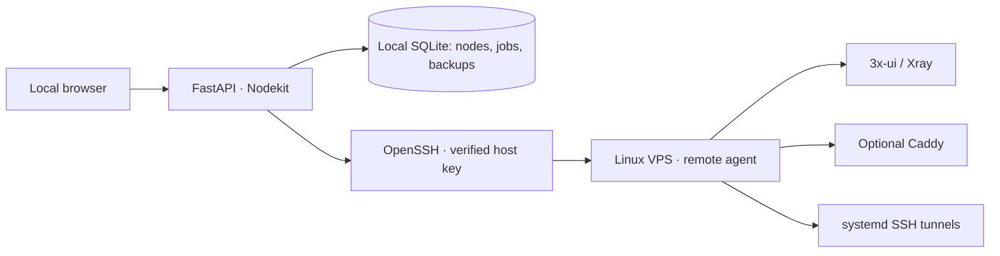

# OMSI Nodekit

**Local-first control panel for 3x-ui / Xray nodes, SSH tunnels, backups and subscription diagnostics.**

[](https://github.com/shiaOmsword/omsi-nodekit/actions/workflows/tests.yml)
[](backend/pyproject.toml)
[](frontend/package.json)

[Русский / Russian](readme.md) · [First-run guide (RU)](docs/faq.md) · [Architecture](docs/architecture.md)

OMSI Nodekit is a **locally hosted** web application for people running their own 3x-ui / Xray Linux servers. Instead of manually repeating the same installation, disaster-recovery and routing steps, it provides server discovery, an explicit change plan, SSH execution, progress logs and backups.

The web UI and API listen on **127.0.0.1 by default**. Nodekit communicates with VPS hosts over OpenSSH and uses a scoped remote agent; it is **not** a commercial VPN provider, hosted control plane or client VPN app.

> **Maturity:** early 0.x, not a stable general-purpose installer. Review the plan and take a backup before modifying production services; rehearse deployment and recovery on a disposable VPS.

## Features

| Area | Available today |
| --- | --- |
| Discovery & diagnostics | Detect native, Docker and managed 3x-ui; inspect Caddy, TLS, ports, UFW, available tools and network routes |
| Deployment | Provision a new Nodekit-managed native or Docker 3x-ui, with optional Caddy and initial VLESS/REALITY inbounds |
| Backups & recovery | Consistent SQLite snapshots, integrity checks, restore to a **new** VPS, selective client migration preserving UUID/subId |
| VLESS & subscriptions | Manage supported inbounds and clients, VLESS/XHTTP over a private backend and Caddy TLS; audit public subscription HTTPS/DNS without logging bearer tokens |
| Cache maintenance | Explicitly confirmed server cache reset by restarting **only an owned Docker panel container**; no client-side DNS or app cache reset |
| SSH egress | SSH port forwarding, multiple sessions, guarded Xray routing and troubleshooting |
| Safety | Preview plans, revision/fingerprint checks, ownership guards, job logs and concurrency locks |

**Scope:** existing native and Docker installations can be inspected, diagnosed and backed up. Changing server infrastructure requires an explicitly supported Nodekit-managed deployment. Nodekit does not take over someone else's Caddy configuration.

## Architecture



Tech stack: **Python 3.12, FastAPI, Pydantic, SQLite, Poetry, punq**; **React, TypeScript, Vite**. See [architecture details](docs/architecture.md).

## Quick start

On your **local computer**, install Python **3.12+**, Poetry **2.x**, Node.js **22.12+** (or compatible 24 LTS), npm and OpenSSH. Windows and Linux are supported; WSL is also suitable on Windows.

```bash
git clone https://github.com/shiaOmsword/omsi-nodekit.git
cd omsi-nodekit/frontend
npm ci
npm run build

cd ../backend
poetry install --with dev
poetry run nodekit
```

Open **http://127.0.0.1:8765**; FastAPI serves the built frontend. The development API docs are at http://127.0.0.1:8765/docs. No second Node process is needed for normal use. To develop the React frontend, run `cd frontend && npm run dev`.

Optional local settings: copy `backend/.envs/.local.example.env` to `backend/.envs/.local.env`. Local databases, managed SSH keys and backups are stored under `backend/data/` by default and **must never be committed**.

### First VPS connection

The remote Linux host needs Python **3.11+**, SSH key authentication and a verified host key. Docker and Compose are required for Docker deployments; systemd is required for supported native deployments. Mutating operations require adequate root/sudo privileges.

1. Connect with OpenSSH manually using the exact port, user, identity and `known_hosts` file; verify the server fingerprint out of band.
2. Add a node with the [example configuration](backend/config/config-example.yaml) and replace all example values.
3. Run **Discover** first (read-only). Inspect the report before choosing a deployment or management action.
4. Review the generated **plan** and confirm modifications only for a VPS you control.
5. Test recovery with a disposable host before using a production database.

The detailed [first-run guide](docs/faq.md) and [existing-node guide](docs/existing-nodes.md) are currently in Russian.

## Documentation

- [Adaptive provisioning: native / Docker / Caddy](docs/adaptive-deployment.md)
- [Subscription and client management](docs/subscriptions.md); [server-side cache maintenance](docs/subscription-maintenance.md)
- [VLESS/XHTTP/TLS transport setup](docs/working-transports.md)
- [SSH egress and Xray routing](docs/ssh-egress.md)
- [Backup recovery rehearsal](docs/restore-rehearsal.md)
- [Network and firewall changes](docs/network-management.md)
- [Architecture](docs/architecture.md) and [development roadmap](docs/deployment-roadmap.md)

## Security boundaries

- **Do not expose Nodekit's local API directly to the Internet.** It can manage server access and sensitive local data. Use SSH port forwarding to access the 3x-ui administrative interface.
- `ssh.sudo_password` stored in local YAML/SQLite is **not encrypted**. Prefer `ssh.sudo_password_env`, a protected local environment and least-privilege access.
- 3x-ui SQLite backups can contain user identifiers, private Xray material and subscription secrets; never upload real backups or full unredacted logs to Issues.
- A successful TCP check, HTTPS check or local probe is not proof that a VPN client works from every network.
- A panel restart may interrupt every connected VPN client. Cache maintenance is intentionally manual and ownership-guarded.
- Please follow [SECURITY.md](SECURITY.md) for security reports.

## Development & contributions

```bash
cd backend
poetry run ruff check src tests
poetry run ruff format --check src tests
poetry run pytest -q

cd ../frontend
npm test
npm run build
```

CI runs on **Ubuntu and Windows**. Use a feature branch off `dev`, open a pull request, and read [CONTRIBUTING.md](CONTRIBUTING.md) before proposing changes. Bugs and ideas belong in [Issues](https://github.com/shiaOmsword/omsi-nodekit/issues), except for sensitive vulnerability reports.

**License:** no open-source license has been selected. Public source availability alone does not grant permission to reproduce, modify or redistribute this project beyond applicable GitHub terms. Confirm licensing terms with the maintainer before reuse.
