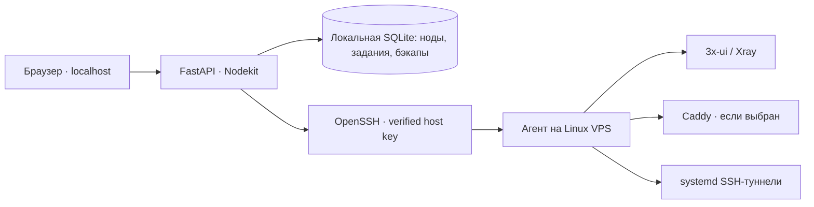

# OMSI Nodekit

**Local-first control panel for 3x-ui / Xray nodes, SSH tunnels, backups and subscription diagnostics.**

[](https://github.com/shiaOmsword/omsi-nodekit/actions/workflows/tests.yml)
[](backend/pyproject.toml)
[](frontend/package.json)

**Документация:** Русский (эта страница) · [English](README.en.md) · [Первый запуск](docs/faq.md) · [Архитектура](docs/architecture.md)

OMSI Nodekit — локальное веб-приложение для управления собственными Linux VPS с 3x-ui и Xray. Оно помогает повторяемо проверять инфраструктуру, планировать изменения, восстанавливать панель и клиентов, управлять VLESS inbound и SSH-туннелями, не собирая конфигурацию вручную после каждой миграции.

Приложение работает **на вашем компьютере**, подключается к VPS по SSH и выполняет операции через ограниченный агент. Веб-интерфейс и API по умолчанию доступны только на `127.0.0.1`.

> **Статус:** ранняя версия 0.x для самостоятельного использования. Перед изменениями на рабочем сервере проверьте план, сделайте резервную копию и проведите пробный запуск на отдельной VPS. Поддержка топологий ограничена и описана в документации; успешные тесты не гарантируют совместимость с произвольной установкой.

## Возможности

| Раздел | Что доступно |
| --- | --- |
| Ноды и обнаружение | Поиск 3x-ui (native / Docker / managed), проверка Caddy, TLS, портов, маршрутов, UFW и окружения |
| Развёртывание | Новая Nodekit-managed панель 3x-ui (native или Docker), опциональный Caddy и стартовые VLESS/REALITY inbound |
| Бэкапы и восстановление | Согласованные SQLite-снимки, проверка целостности, restore на **новую** VPS, выборочный перенос VLESS-клиентов с UUID/subId |
| Inbound и клиенты | Просмотр, изменение и удаление управляемых inbound, добавление/удаление клиентов, VLESS/XHTTP с приватным backend и публичным TLS через Caddy |
| Подписки | Проверка выдачи HTTPS, DNS с VPS, TLS и содержимого ответа без записи токенов в журнал; ручной сброс серверного кэша только через подтверждённый рестарт **своего** Docker-контейнера |
| SSH-выход | Настройка защищённого SSH forwarding, нескольких туннелей, маршрутизации Xray, диагностика соединений и откат поддерживаемых операций |
| Безопасное выполнение | Предварительный план, подтверждение изменений, сверка fingerprint/revision, проверки ownership, журнал задач и ограничение параллельных операций |

**Важно:** существующие сторонние native/Docker-панели можно обнаруживать, диагностировать и резервировать; операции изменения инфраструктуры требуют поддерживаемой Nodekit-managed установки. Программа не перехватывает чужие Caddy-сайты, не очищает кэш приложений V2BOX/Hiddify и не гарантирует доступность VPN только по факту открытого TCP-порта.

## Как это устроено



Backend: **Python 3.12, FastAPI, Pydantic, SQLite, Poetry, punq**. Frontend: **React, TypeScript, Vite**. Компоненты приложения разделены на `framework`, `app/entities`, `app/services` и `app/infrastructure` — подробнее в [документе об архитектуре](docs/architecture.md).

## Быстрый запуск

На компьютере нужны **Python 3.12+**, **Poetry 2.x**, **Node.js 22.12+** (или совместимая 24 LTS), npm и **OpenSSH**. Поддерживаются Windows и Linux; на Windows можно работать напрямую или целиком в WSL. Локальные пути к SSH-ключам должны соответствовать среде, где запущен backend.

```bash
git clone https://github.com/shiaOmsword/omsi-nodekit.git
cd omsi-nodekit/frontend
npm ci
npm run build

cd ../backend
poetry install --with dev
poetry run nodekit
```

Откройте **http://127.0.0.1:8765**. FastAPI отдаёт уже собранный frontend — отдельный Vite-процесс для обычного запуска не требуется. OpenAPI: http://127.0.0.1:8765/docs.

Опционально скопируйте `backend/.envs/.local.example.env` в `backend/.envs/.local.env`. Локальная база, ключи и резервные копии по умолчанию хранятся в `backend/data/` и **не предназначены для Git**.

Для frontend-разработки: `cd frontend && npm run dev` (http://127.0.0.1:5173). Для удалённых операций используйте обычный backend без `--reload`.

### Подготовка VPS

Нужна **Linux VPS** с Python 3.11+, доступом по SSH-ключу и проверенным `known_hosts`. Для Docker-развёртывания — Docker Engine и Compose; для native-варианта — поддерживаемый Linux/systemd. Права root или настроенный sudo требуются для операций, меняющих систему. Параметры зависят от выбранного сценария.

1. Проверьте SSH-соединение вручную и сверьте fingerprint хоста с доверенным источником.
2. Добавьте ноду в приложении, используя [пример YAML](backend/config/config-example.yaml) с **тестовыми** адресами.
3. Сохраните YAML и начните с **«Обнаружение»** (read-only).
4. Изучите результат, выберите поддерживаемую установку и нажмите **«Показать план»** перед любой изменяющей операцией.
5. Восстановление и опасные изменения сначала тестируйте на отдельной VPS.

Полная пошаговая инструкция: [docs/faq.md](docs/faq.md). Подробнее о работе с существующей установкой: [docs/existing-nodes.md](docs/existing-nodes.md).

## Документация

| Тема | Руководство |
| --- | --- |
| Первое подключение, SSH/sudo, ошибки | [FAQ / первый запуск](docs/faq.md) |
| Новая native/Docker-панель и Caddy | [Адаптивное развёртывание](docs/adaptive-deployment.md) |
| Работа с существующей 3x-ui | [Обнаружение и диагностика](docs/existing-nodes.md) |
| Подписки, клиентские профили, HTTPS | [Подписки](docs/subscriptions.md), [обслуживание кэша](docs/subscription-maintenance.md) |
| VLESS/XHTTP/TLS | [Рабочие транспортные схемы](docs/working-transports.md) |
| SSH forwarding, Xray routing | [SSH-egress](docs/ssh-egress.md) |
| Восстановление и резервирование | [Проверка восстановления](docs/restore-rehearsal.md) |
| UFW, Caddy и порты | [Управление сетью](docs/network-management.md) |
| Исходный код и проектирование | [Архитектура](docs/architecture.md), [roadmap](docs/deployment-roadmap.md) |

## Безопасность и ограничения

- **Не выставляйте Nodekit API в публичную сеть.** Он управляет SSH-подключениями, локальными ключами и резервными копиями. Для доступа к самой 3x-ui используйте SSH port forwarding, а не открывайте административный порт в интернет.
- `ssh.sudo_password` в локальном YAML/SQLite **не шифруется**. Предпочтительнее `ssh.sudo_password_env` и минимально необходимые полномочия.
- Бэкапы 3x-ui содержат приватные клиентские идентификаторы и конфигурацию Xray. Не публикуйте базы, SSH-ключи, private keys, подписки, реальные адреса серверов или полные логи.
- Nodekit не является средством обхода всех сетевых ограничений: диагностика TCP, DNS или локального HTTPS не заменяет проверку с реального устройства.
- Любая операция рестарта панели может прервать соединения. Перед применением проверьте **ownership**, план, свежесть отчёта и наличие актуального backup.
- Если нашли уязвимость, следуйте [SECURITY.md](SECURITY.md), а не публикуйте exploit или секреты в Issues.

## Проверки и участие

```bash
cd backend
poetry run ruff check src tests
poetry run ruff format --check src tests
poetry run pytest -q

cd ../frontend
npm test
npm run build
```

В GitHub Actions проверки выполняются на **Ubuntu и Windows**. Для предложений и ошибок используйте [Issues](https://github.com/shiaOmsword/omsi-nodekit/issues), для изменений — ветку от `dev` и PR. Перед участием прочитайте [CONTRIBUTING.md](CONTRIBUTING.md). Секреты и реальные данные VPS в баг-репорты не добавляйте.

**Лицензия:** пока не выбрана. Код открыт для просмотра, но публичность репозитория сама по себе не предоставляет открытую лицензию на копирование и распространение. Перед использованием за пределами условий GitHub необходимо согласовать условия с автором.

---

<details>
<summary>English summary</summary>

OMSI Nodekit is a local-first control panel for administering your own Linux VPS with 3x-ui / Xray. It supports discovery, guarded provisioning, SQLite backups and restore, VLESS inbound and client management, subscription diagnostics, and SSH egress tunnels. The app runs on your computer and connects over SSH; it is not a hosted VPN service. This is early-stage software. See the [English README](README.en.md) for installation and safety notes.

</details>
